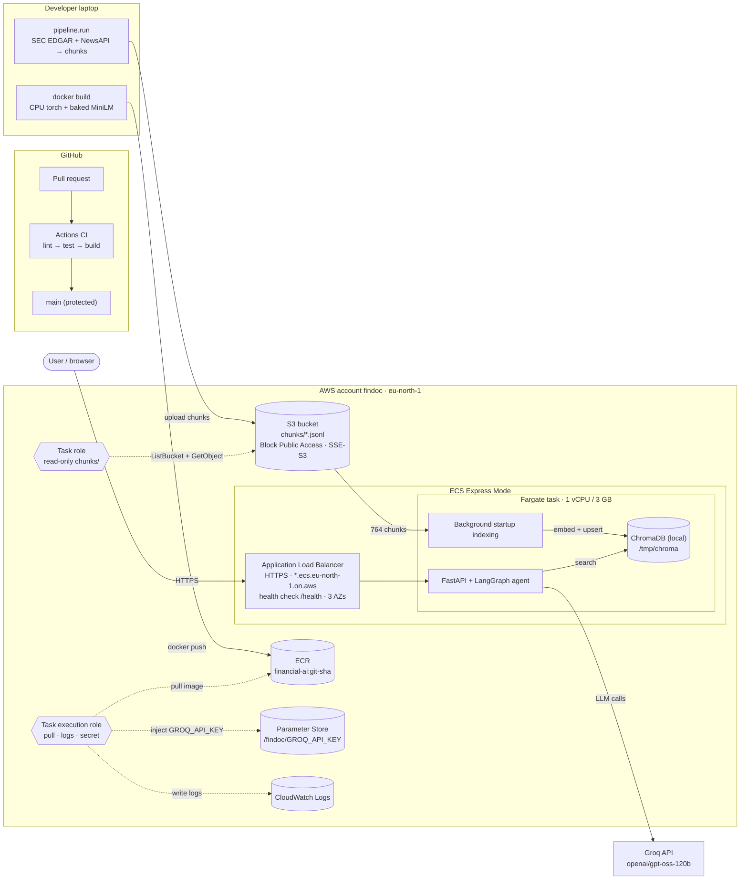
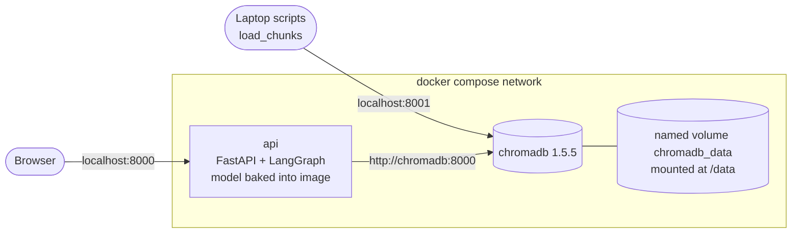
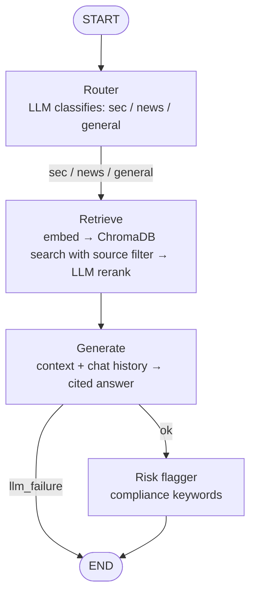
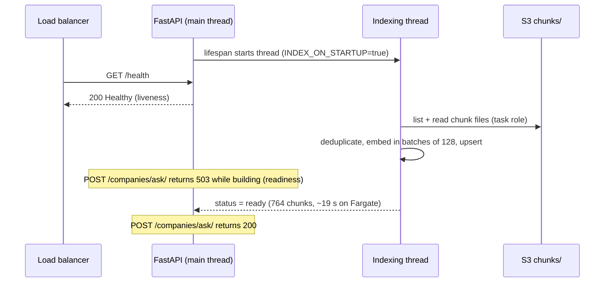

# Financial Document Intelligence

An end-to-end AI system that ingests SEC 10-K filings and financial news, answers natural-language questions with cited sources, flags risk signals, and routes each query through a LangGraph agent.

It runs locally as a Docker Compose stack (FastAPI + ChromaDB), stores its document chunks in Amazon S3, and has been deployed to **AWS ECS on Fargate** behind an HTTPS load balancer, with least-privilege IAM roles and secrets in Parameter Store. Every pull request is checked by GitHub Actions CI.

Built as a portfolio project over a phased plan, targeting Applied AI / ML Engineer / MLOps roles in the UK.

---

## Highlights

| What | Result |
|------|--------|
| **Deployed on AWS** | ECS Express Mode on Fargate (1 vCPU / 3 GB) behind an HTTPS Application Load Balancer. Verified end to end over HTTPS: `/health`, Swagger, and `/companies/ask/` returning cited answers. Torn down between demos to control cost, and redeployable from the image in ECR. |
| **No keys in the container** | The app reads S3 through an ECS **task role** (read-only on `chunks/`), and the Groq key is injected from **Parameter Store** by the **task execution role**. No AWS keys or plain-text secrets in code, image or task definition. |
| **Liveness vs readiness** | The vector index is rebuilt from S3 in a **background thread** at startup. `/health` answers immediately (verified during indexing, from all 3 load-balancer AZs), while `/companies/ask/` returns **503** until the index is ready. Indexing 764 chunks took **18.6 s on Fargate**. |
| **S3-backed storage** | Chunks live in S3 (Block Public Access on, SSE-S3 encryption). Saves **merge by `chunk_id`** because S3 has no append, making pipeline re-runs idempotent. |
| **Docker image size** | 8.98 GB → **2.49 GB** on disk (3.05 GB → **528 MB** compressed) by switching to CPU-only PyTorch. Diagnosed with `docker history` and `pip list` inside the container: Linux PyTorch from PyPI pulled 15 `nvidia-*` CUDA packages the app never uses. |
| **Offline-capable container** | The embedding model is baked into the image at build time. Verified with `HF_HUB_OFFLINE=1`: the container starts and embeds with no network access to Hugging Face. |
| **CI quality gate** | Lint, tests and a Docker build run on every pull request. A branch ruleset blocks merging into `main` until all three pass. |
| **LLM provider change** | When Groq retired the original model, structured logs pinpointed `model_not_found` across all agent nodes. The model name now lives in config, so the next migration is a one-line `.env` change. |

---

## Architecture

### Deployment (AWS, eu-north-1)

Solid arrows show data flow; dotted arrows show which IAM role grants which access.



### Local runtime (Docker Compose)



The API waits for ChromaDB to pass a healthcheck (`depends_on: condition: service_healthy`). The healthcheck uses bash's `/dev/tcp`, because the ChromaDB image ships without curl, wget or Python.

### Agent request flow (LangGraph)



### Startup: liveness vs readiness



---

## Project status

| Phase | Scope | Status |
|-------|-------|--------|
| 1 | REST API: FastAPI, Pydantic, pytest, structured JSON logging | ✅ |
| 2 | Data pipeline: SEC EDGAR + NewsAPI ingestion, HTML parsing, chunking, JSONL storage | ✅ |
| 3 | RAG: sentence-transformers embeddings, ChromaDB, LLM reranker, cited answers | ✅ |
| 4 | LangGraph agent: routing, risk flagging, conversation memory, error handling | ✅ |
| 5 | Deployment | 🟡 In progress |
|   | ↳ Docker image (CPU torch, baked model) | ✅ |
|   | ↳ Docker Compose stack with persistent ChromaDB | ✅ |
|   | ↳ GitHub Actions CI + branch protection | ✅ |
|   | ↳ S3 storage mode with moto tests | ✅ |
|   | ↳ ECR + ECS Express (Fargate), IAM roles, Parameter Store | ✅ |
|   | ↳ Terraform, Prometheus + Grafana | ⏳ |
| 6 | Evaluation (RAGAS, golden test set), MLflow, React frontend | ⏳ |

---

## Quick start

### Option A: Docker Compose (recommended for local use)

Requires Docker Desktop.

```bash
git clone https://github.com/arbaz-shaik/financial-doc-intelligence.git
cd financial-doc-intelligence

# 1. Configure secrets: copy the template, then add your keys
cp .env.example .env

# 2. Start the stack (API + ChromaDB) in the background
make docker-up
```

The API is now at http://localhost:8000 (Swagger UI at `/docs`), and ChromaDB at http://localhost:8001.

**Load documents into the ChromaDB container.** This runs from your laptop, against the exposed port:

```bash
python -m venv .venv
# Windows: .venv\Scripts\activate    macOS/Linux: source .venv/bin/activate
pip install -r requirements-dev.txt

python -m pipeline.run                          # fetch + parse + chunk → data/chunks/
CHROMA_MODE=http python -m scripts.load_chunks  # embed + store in the ChromaDB container
```

On Windows PowerShell, set the variable first: `$env:CHROMA_MODE="http"; python -m scripts.load_chunks`.

Saves merge by `chunk_id`, so re-running the pipeline updates chunks instead of duplicating them.

Stop the stack with `make docker-down`. Data persists in the `chromadb_data` volume. **Do not add `-v`**, which deletes the volume.

### Option B: Local development (no Docker)

```bash
pip install -r requirements-dev.txt
python -m pipeline.run
python -m scripts.load_chunks     # local mode: writes to ./data/vectors
make run                          # uvicorn on http://localhost:8000
make test                         # pytest
```

### Option C: Load chunks from S3

With AWS credentials available through the standard credential chain (for example `AWS_PROFILE`):

```bash
STORAGE_MODE=s3 S3_BUCKET=<your-bucket> python -m scripts.load_chunks
```

### Deploying to AWS (ECS Express Mode)

1. Build the image and push it to ECR, tagged with the git commit SHA.
2. Store `GROQ_API_KEY` as a SecureString under `/findoc/` in Parameter Store.
3. Create two roles:
   - **Task execution role:** `AmazonECSTaskExecutionRolePolicy` plus `ssm:GetParameters` on `/findoc/*`
   - **Task role:** `s3:ListBucket` limited to the `chunks` prefix, and `s3:GetObject` on `chunks/*` (no write or delete)
4. Create an Express Mode service: port `8000`, health check `/health`, 1 vCPU / 3 GB, max 1 task, `GROQ_API_KEY` as a **secret** (Parameter Store ARN), and these environment variables:

   ```
   STORAGE_MODE=s3
   S3_BUCKET=<your-bucket>
   CHROMA_MODE=local
   CHROMA_PATH=/tmp/chroma
   INDEX_ON_STARTUP=true
   HF_HUB_OFFLINE=1
   ```

5. **Tear down** after use (delete the service), then confirm no load balancer remains.

---

## Configuration

All settings are read by Pydantic `Settings` (`src/config.py`) from environment variables or `.env`. Required secrets have **no defaults**, so the app fails fast at startup if they are missing.

| Variable | Required | Default | Purpose |
|----------|----------|---------|---------|
| `GROQ_API_KEY` | ✅ | — | LLM provider key |
| `NEWS_API_KEY` | Pipeline only | — | NewsAPI key. Optional for the API; `pipeline.run` checks for it before running |
| `SEC_USER_AGENT` | | placeholder | Required by SEC EDGAR (`Name/1.0 email`) |
| `MODEL_NAME` | | `openai/gpt-oss-120b` | Groq model ID |
| `CHROMA_MODE` | | `local` | `local` (embedded `PersistentClient`) or `http` (ChromaDB server). Any other value fails at startup |
| `CHROMA_HOST` | | `localhost` | Server host in `http` mode (`chromadb` inside Compose) |
| `CHROMA_PORT` | | `8001` | Server port in `http` mode (`8000` inside Compose) |
| `CHROMA_PATH` | | `./data/vectors` | Storage path in `local` mode |
| `STORAGE_MODE` | | `local` | Where chunks are read from and written to: `local` or `s3` |
| `CHUNKS_DIR` | | `./data/chunks` | Chunk folder in `local` storage mode |
| `S3_BUCKET` | In `s3` mode | — | Bucket holding the chunks |
| `S3_PREFIX` | | `chunks` | Key prefix for chunk files |
| `AWS_REGION` | | `eu-north-1` | Region for the S3 client |
| `INDEX_ON_STARTUP` | | `false` | Build the vector index from storage in a background thread at startup |

AWS credentials are never configured in the app: locally they come from your CLI profile, and on ECS from the task role.

> When passing `.env` to `docker run --env-file`, use plain `NAME=value` lines with **no quotes and no spaces** around `=`. Docker keeps them literally.

---

## API

| Method | Endpoint | Description |
|--------|----------|-------------|
| GET | `/health` | Liveness check (independent of ChromaDB, indexing and the LLM) |
| POST | `/companies` | Add a company |
| GET | `/companies` | List all companies |
| GET | `/companies/search/` | Search by sector or name |
| GET | `/companies/{ticker}` | Get a company by ticker |
| POST | `/companies/ask/` | Ask a question (agent-powered). Returns **503** while the startup index is building, or if it failed |

### Example

Request:

```json
{
  "question": "What are Apple's key risk factors in their latest 10-K filing?",
  "top_k": 5,
  "chat_history": []
}
```

Response (abridged):

```json
{
  "route": "sec",
  "answer": "Apple's 2025 Form 10-K lists risk factors that could materially adversely affect its business... Supply shortages and price increases [AAPL-10-K-0000320193-25-000079-chunk-0149] ... frequent product and service transitions [AAPL-10-K-0000320193-25-000079-chunk-0134] ... privacy and security changes [AAPL-10-K-0000320193-25-000079-chunk-0241] ...",
  "sources": [
    {"chunk_id": "AAPL-10-K-0000320193-25-000079-chunk-0094", "relevance": 0.72},
    {"chunk_id": "AAPL-10-K-0000320193-25-000079-chunk-0134", "relevance": 0.66},
    {"chunk_id": "AAPL-10-K-0000320193-25-000079-chunk-0241", "relevance": 0.65}
  ],
  "risk_flags": ["material adverse effect"]
}
```

For follow-up questions, send previous turns in `chat_history` as `{"question": ..., "answer": ...}` objects. The API is stateless: the client keeps the history.

---

## CI/CD

`.github/workflows/ci.yml` runs on every pull request to `main` and every push to `main`:

| Job | What it does | Notes |
|-----|--------------|-------|
| `lint` | `ruff check .` | Installs only ruff, not the full dependency set |
| `test` | `pytest` with dummy API keys | CPU-only torch installed first; pip cache keyed on both requirements files; 60 s per-test timeout; **no AWS credentials** |
| `build` | `docker build` | Runs only after `lint` and `test` pass |

A repository ruleset requires all three checks before anything merges into `main`. This was verified by pushing a deliberately broken test to an open PR: the PR went red and merging was blocked until it was fixed.

**Dependencies are split:** `requirements.txt` holds runtime packages only (what the Docker image installs), and `requirements-dev.txt` includes it with `-r` and adds pytest, pytest-timeout, ruff and moto.

---

## Testing

- **15 tests**: API endpoints, chunker behaviour, HTML parsing, the SEC client (HTTP mocked), the S3 chunk store, and the indexer.
- **S3 is mocked with moto**: a shared fixture in `tests/conftest.py` sets fake credentials, so tests can never reach real AWS, and CI runs with no AWS credentials at all.
- **The indexer test** uses a moto bucket, a fake embedder (no model download) and a throwaway ChromaDB in `tmp_path`. It checks both the returned count and what was actually stored, including de-duplication across files.
- Tests pass with **dummy API keys**, so no test calls Groq or NewsAPI.
- `pytest.ini` limits collection to `tests/`.

**Known gap:** the agent nodes (router, retrieve, generate, risk flagger) are not yet unit-tested. The lazy getters in `src/agent/nodes.py` make this possible by patching `get_llm()` / `get_store()` with fakes.

---

## Engineering notes

Problems hit during the build, and what fixed them:

- **An organisation SCP denied every region except `eu-north-1`.** `CreateBucket` in `eu-west-2` failed with an explicit deny, even with `AdministratorAccess`, because an explicit `Deny` in a Service Control Policy overrides any IAM `Allow`. The project moved to `eu-north-1`.
- **`async def` blocked `/health`.** The `/ask` endpoint was `async def` but called the blocking agent, freezing the event loop during LLM calls, so health checks could time out. Changing it to plain `def` lets FastAPI run it in a worker thread.
- **The first image built for ECS didn't contain the new code.** A one-line `docker run ... python -c "..."` check before pushing caught it, and the image was rebuilt from the merged commit and tagged with that commit's SHA.
- **Chunker never terminated** when the final chunk was shorter than `chunk_size` (`start` reset to `end - overlap` forever). Fixed by stopping after the final chunk and forcing `start` to advance. This also explained a hanging test.
- **88 news articles collapsed into 1 stored chunk**, because chunk IDs restarted at 0 per document. IDs now include a required `doc_id`: the SEC accession number for filings, and a short MD5 of the URL for news.
- **`depends_on` alone doesn't wait for readiness:** it waits for a container to *start*, not for its service to accept connections. Fixed in Compose with a healthcheck gate, and in the app with lazy initialisation.
- **PowerShell `>` wrote `requirements.txt` as UTF-16**, which was caught by inspecting the first bytes with `Format-Hex` and converted to UTF-8.

---

## Known limitations / roadmap

- The index is rebuilt inside each container at startup; scaling to several tasks would need a shared, managed vector store
- Successful health checks are logged on every call (CloudWatch noise and cost)
- `ChunkStore` lives in `pipeline/`, so the image copies that folder too; it belongs in `src/`
- Parser leaves some XBRL markup in early chunks, and financial tables are flattened into unstructured text
- No section extraction yet (Risk Factors, MD&A)
- Risk flagger uses exact-phrase matching on the answer, so it misses word variants and trusts unsupported claims
- Citation format varies between model runs, and answers sometimes omit citations; citations should be parsed and validated
- Retrieval ignores chat history (follow-ups need query rewriting before retrieval)
- No company filter at query time (needed before ingesting multiple companies)
- News ingestion queries by ticker, which returns some irrelevant results
- If the LLM is unavailable, the reranker failure also empties retrieval results
- Planned: Terraform, Prometheus + Grafana, RAGAS evaluation, MLflow, React frontend

---

## Project structure

```
financial-doc-intelligence/
├── .github/workflows/ci.yml   # lint → test → docker build
├── Dockerfile                 # python:3.13-slim, CPU torch, baked model, src/ + pipeline/
├── docker-compose.yml         # api + chromadb, named volume, healthcheck
├── Makefile                   # run, test, docker-up, docker-down
├── pytest.ini
├── requirements.txt           # runtime dependencies
├── requirements-dev.txt       # -r requirements.txt + pytest, ruff, moto
├── src/
│   ├── config.py              # Pydantic Settings (all configuration)
│   ├── logger.py              # structured JSON logging
│   ├── main.py                # FastAPI app, startup indexing, readiness gate
│   ├── models.py              # request/response schemas
│   ├── rag/                   # embedder, vector_store, llm, reranker, prompts, indexer
│   └── agent/                 # state, nodes (lazy getters), graph
├── pipeline/                  # sec_client, news_client, parser, chunker, store, run
├── scripts/                   # load_chunks and experiment scripts
├── docs/                      # architecture diagrams, AWS notes, screenshots
└── tests/                     # API, pipeline, S3 store (moto), indexer; shared fixtures in conftest.py
```

---

## Tech stack

Python 3.13 · FastAPI · Pydantic · LangGraph · ChromaDB · sentence-transformers (all-MiniLM-L6-v2) · Groq (openai/gpt-oss-120b) · BeautifulSoup4 · httpx · boto3 · pytest · moto · ruff · Docker · Docker Compose · GitHub Actions · AWS (S3, ECR, ECS Fargate, IAM, Parameter Store, CloudWatch)