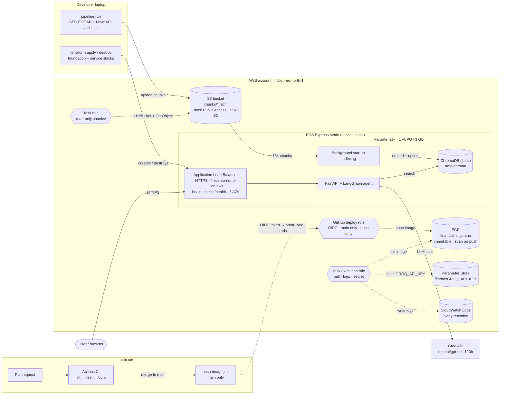
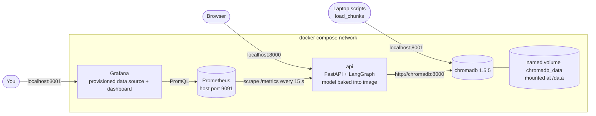
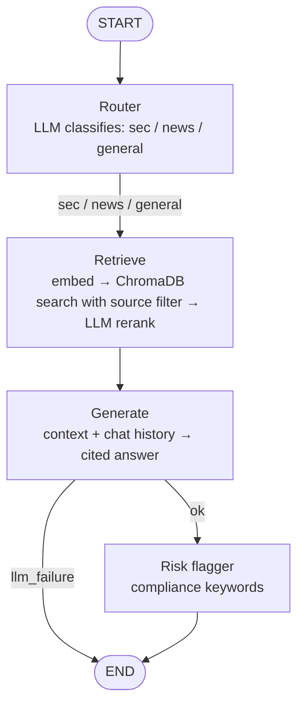
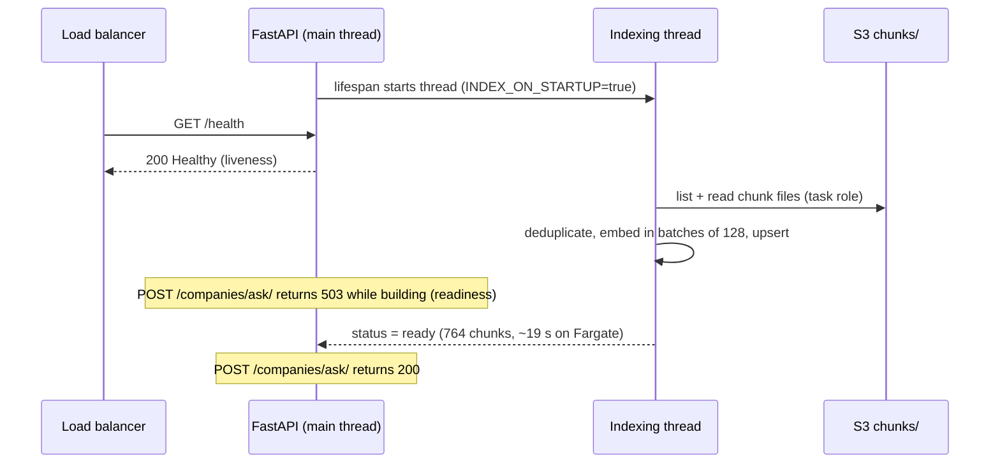
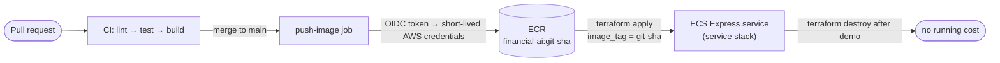
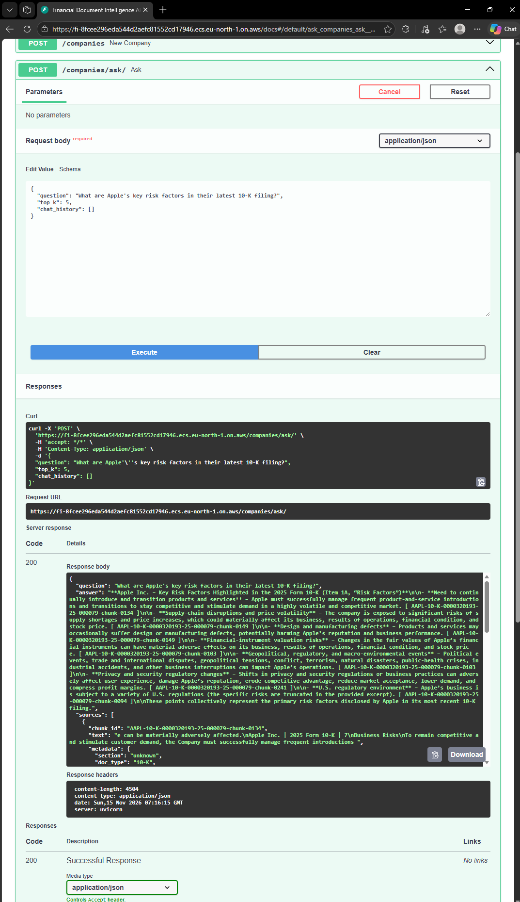

# Financial Document Intelligence

An end-to-end AI system that ingests SEC 10-K filings and financial news, answers natural-language questions with cited sources, flags risk signals, and routes each query through a LangGraph agent.

It runs locally as a Docker Compose stack (FastAPI, ChromaDB, Prometheus, Grafana), stores its document chunks in Amazon S3, and deploys to **AWS ECS on Fargate** behind an HTTPS load balancer. All AWS infrastructure is defined in **Terraform**, every merge to `main` builds and pushes a versioned image through **GitHub Actions with OIDC** (no stored AWS keys), the API is instrumented with **Prometheus** metrics and a **Grafana** dashboard provisioned as code, and answer quality is measured against a hand-written **golden set** with deterministic checks and LLM-judged scores.

Built as a portfolio project over a phased plan, targeting MLOps, DevOps and Applied AI Engineer roles in the UK.

---

## Highlights

| What | Result |
|------|--------|
| **Evaluation** | 30-question golden set with a validator; deterministic checks (retrieval hit@5 82%, routing 57%, end-to-end hit@5 50%) and LLM-judged scores with an independent judge. Every failure traced to a pipeline stage: routing is the largest. Found that RAGAS's "recall" mixes answer and reference claims, and replaced it with a reference-coverage metric validated by known-answer tests. |
| **Infrastructure as code** | All AWS resources in Terraform, split into a long-lived **foundation** stack (S3, ECR, IAM: 9 existing resources imported with zero drift) and a short-lived **service** stack (ECS Express) created for demos and destroyed after. `prevent_destroy` on data; secrets never enter state. |
| **Continuous delivery, no stored keys** | Every merge to `main` builds and pushes an image tagged with the commit SHA. GitHub Actions assumes an AWS role through **OIDC**, trusted only for this repository's `main` branch (pinned to GitHub's numeric owner and repo IDs). GitHub holds **no AWS secrets**. |
| **Monitoring** | Prometheus metrics (HTTP plus AI-specific: queries by route, LLM latency and failures, index state) and a Grafana dashboard provisioned as code. Found a misleading p95 of exactly 1 s caused by default histogram buckets; the real p95 was 7–9.5 s, dominated by 3 LLM calls per question. |
| **Deployed on AWS** | ECS Express Mode on Fargate (1 vCPU / 3 GB) behind an HTTPS Application Load Balancer. Verified end to end over HTTPS: `/health`, Swagger, and `/companies/ask/` returning cited answers, from an image built and pushed by CI. |
| **No keys in the container** | The app reads S3 through an ECS **task role** (read-only on `chunks/`), and the Groq key is injected from **Parameter Store** by the **task execution role**. No AWS keys or plain-text secrets in code, image or task definition. |
| **Liveness vs readiness** | The vector index is rebuilt from S3 in a **background thread** at startup. `/health` answers immediately (verified during indexing, from all 3 load-balancer AZs), while `/companies/ask/` returns **503** until the index is ready. Indexing 764 chunks took **18.6 s on Fargate**. |
| **S3-backed storage** | Chunks live in S3 (Block Public Access on, SSE-S3 encryption). Saves **merge by `chunk_id`** because S3 has no append, making pipeline re-runs idempotent. |
| **Docker image size** | 8.98 GB → **2.49 GB** on disk (3.05 GB → **528 MB** compressed) by switching to CPU-only PyTorch. Diagnosed with `docker history` and `pip list` inside the container: Linux PyTorch from PyPI pulled 15 `nvidia-*` CUDA packages the app never uses. |
| **Offline-capable container** | The embedding model is baked into the image at build time. Verified with `HF_HUB_OFFLINE=1`: the container starts and embeds with no network access to Hugging Face. |
| **CI quality gate** | Lint, tests and a Docker build run on every pull request. A branch ruleset blocks merging into `main` until all three pass. |

---

## Architecture

### Deployment (AWS, eu-north-1)

Solid arrows show data flow; dotted arrows show which IAM role grants which access.



### Local runtime (Docker Compose)



The API waits for ChromaDB to pass a healthcheck (`depends_on: condition: service_healthy`). The healthcheck uses bash's `/dev/tcp`, because the ChromaDB image ships without curl, wget or Python. Prometheus and Grafana use host ports 9091 and 3001, so they never clash with other local stacks on the default ports.

### Agent request flow (LangGraph)



### Startup: liveness vs readiness



---

## Deployment pipeline



This is **continuous delivery**, not continuous deployment: CI guarantees a tested, versioned image for every merge, and deploying it is a deliberate `terraform apply`. The service stack is short-lived for cost control, so most of the time there is nothing running to deploy to.

The push job is **idempotent**: ECR tags are immutable, so it checks whether the commit's image already exists and skips the push if so, which makes re-runs safe.

### Running the Terraform stacks

```bash
# Long-lived foundation (once): S3, ECR, IAM roles, GitHub OIDC
cd infra/foundation
terraform init
terraform plan -out tfplan && terraform apply tfplan

# Short-lived service (per demo): set image_tag in dev.tfvars to a commit SHA in ECR
cd ../service
terraform init
terraform plan -var-file=dev.tfvars -out tfplan && terraform apply tfplan
# ... demo ...
terraform plan -destroy -var-file=dev.tfvars -out destroy.tfplan && terraform apply destroy.tfplan
```

On Windows PowerShell, quote flags that contain a dot: `"-var-file=dev.tfvars"`.

The service stack reads the foundation's outputs with `terraform_remote_state`. That is safe because foundation state contains no secret values: the Groq key lives in Parameter Store, and Terraform only handles its ARN.



---

## Monitoring

`docker compose up` starts the API, ChromaDB, **Prometheus** (http://localhost:9091) and **Grafana** (http://localhost:3001). The data source and dashboard are provisioned from files in `monitoring/`, so no manual setup is needed.


| Metric | Type | Why |
|---|---|---|
| `http_requests_total`, `http_request_duration_highr_seconds` | Counter, histogram | Request rate, errors and latency. `/health` is excluded, so load-balancer checks don't inflate traffic or flatter p95 |
| `findoc_queries_total{route}` | Counter | Which agent route answered (low-cardinality label; the question is never a label) |
| `findoc_llm_call_seconds` | Histogram (buckets 0.5–60 s) | LLM latency, recorded once in the LLM client, so every node is covered |
| `findoc_llm_failures_total` | Counter | LLM errors |
| `findoc_index_status` | Enum | `building` / `ready` / `failed` |

---

## Evaluation

A hand-written 30-question golden set (18 SEC, 4 news, 4 general and 4 unanswerable questions) measures each pipeline stage separately. Expected chunks were found by searching the raw text, never by copying what the system retrieved, and a validator checks every evidence quote verbatim. `make eval` runs every free, deterministic check; LLM-judged scores run in an isolated environment, because RAGAS's dependencies would otherwise change the app's.

| Metric | Baseline |
|---|---|
| Retrieval hit@5 (perfect routing) | 82% |
| Routing accuracy | 57% |
| End-to-end hit@5 | 50% |
| Abstention on unanswerable questions | 4/4 |
| Faithfulness (answered questions only) | 0.94 |

**Most failures happen before generation:** 12 of 26 answerable questions fail at routing and 4 at retrieval, while the generator never wrongly abstains when given the right chunks. Routing errors differ in cost: sending a 10-K question to `news` is fatal (the filter excludes the filing), while sending it to `general` usually still finds the answer.

**Measurements were checked, not trusted.** The judge (`qwen/qwen3.8-27b`) is a different model family from the generator, to limit self-preference bias. RAGAS's `FactualCorrectness` "recall" scored a half-correct answer 0.0; its source showed it counts the *answer's* claims as true positives, so it was replaced by a reference-coverage metric validated with known-answer tests (1.0 / 1.0 / 0.0 / 0.5). A hand spot-check found the judge too strict on two of three answers, so reference coverage is reported as a strict lower bound.

Details, worst five failures and hypotheses for the next iteration: [`docs/evaluation_results.md`](docs/evaluation_results.md). Method and metric definitions: [`evaluation/README.md`](evaluation/README.md).

---

## Cost control

- Compute exists only during demos: `terraform apply` → verify → `terraform destroy`, then CLI checks confirm no services, load balancers or target groups remain
- One task maximum (startup indexing spikes CPU, which could otherwise trigger scale-out)
- ECR lifecycle policy keeps the 10 most recent tagged images
- 7-day CloudWatch log retention
- AWS Budgets alerts on the account

**Region:** everything runs in `eu-north-1`, because an organisation Service Control Policy denies other regions.

---

## Project status

| Phase | Scope | Status |
|-------|-------|--------|
| 1 | REST API: FastAPI, Pydantic, pytest, structured JSON logging | ✅ |
| 2 | Data pipeline: SEC EDGAR + NewsAPI ingestion, HTML parsing, chunking, JSONL storage | ✅ |
| 3 | RAG: sentence-transformers embeddings, ChromaDB, LLM reranker, cited answers | ✅ |
| 4 | LangGraph agent: routing, risk flagging, conversation memory, error handling | ✅ |
| 5 | Deployment | ✅ |
|   | ↳ Docker image, Compose stack, CI + branch protection | ✅ |
|   | ↳ S3 storage, ECR + ECS Express (Fargate), IAM roles, Parameter Store | ✅ |
|   | ↳ Terraform (foundation + service stacks) | ✅ |
|   | ↳ Prometheus + Grafana (provisioned as code) | ✅ |
|   | ↳ Continuous delivery: OIDC image push to ECR on merge | ✅ |
| 6 | Evaluation and ML | 🟡 In progress |
|   | ↳ Golden set, deterministic checks, RAGAS baseline | ✅ |
|   | ↳ Experiments (MLflow), traditional ML model | ⏳ |
| 7 | DevOps platform: Kubernetes (kind), Helm, Argo CD, DevSecOps, autoscaling, Ansible | ⏳ |
| 8 | Polish: answer quality, retrieval, documentation | ⏳ |

---

## Quick start

### Option A: Docker Compose (recommended for local use)

Requires Docker Desktop.

```bash
git clone https://github.com/arbaz-shaik/financial-doc-intelligence.git
cd financial-doc-intelligence

# 1. Configure secrets: copy the template, then add your keys
cp .env.example .env

# 2. Start the stack (API, ChromaDB, Prometheus, Grafana) in the background
make docker-up
```

- API: http://localhost:8000 (Swagger UI at `/docs`)
- ChromaDB: http://localhost:8001
- Prometheus: http://localhost:9091
- Grafana: http://localhost:3001 (dashboard **Findoc → Findoc API**)

**Load documents into the ChromaDB container.** This runs from your laptop, against the exposed port:

```bash
python -m venv .venv
# Windows: .venv\Scripts\activate    macOS/Linux: source .venv/bin/activate
pip install -r requirements-dev.txt

python -m pipeline.run                          # fetch + parse + chunk → data/chunks/
CHROMA_MODE=http python -m scripts.load_chunks  # embed + store in the ChromaDB container
```

On Windows PowerShell, set the variable first: `$env:CHROMA_MODE="http"; python -m scripts.load_chunks`.

Saves merge by `chunk_id`, so re-running the pipeline updates chunks instead of duplicating them.

Stop the stack with `make docker-down`. Data persists in named volumes. **Do not add `-v`**, which deletes them.

### Option B: Local development (no Docker)

```bash
pip install -r requirements-dev.txt
python -m pipeline.run
python -m scripts.load_chunks     # local mode: writes to ./data/vectors
make run                          # uvicorn on http://localhost:8000
make test                         # pytest
make eval                         # free, deterministic evaluation checks
```

### Option C: Load chunks from S3

With AWS credentials available through the standard credential chain (for example `AWS_PROFILE`):

```bash
STORAGE_MODE=s3 S3_BUCKET=<your-bucket> python -m scripts.load_chunks
```

### Deploying to AWS

See [Deployment pipeline](#deployment-pipeline): the foundation stack creates the bucket, ECR repository, IAM roles and GitHub OIDC trust; merging to `main` pushes an image; the service stack deploys a chosen image tag and is destroyed after use. The Groq key must exist as a SecureString at `/findoc/GROQ_API_KEY` in Parameter Store (created outside Terraform, so its value never enters state).

---

## Configuration

All settings are read by Pydantic `Settings` (`src/config.py`) from environment variables or `.env`. Required secrets have **no defaults**, so the app fails fast at startup if they are missing.

| Variable | Required | Default | Purpose |
|----------|----------|---------|---------|
| `GROQ_API_KEY` | ✅ | — | LLM provider key |
| `NEWS_API_KEY` | Pipeline only | — | NewsAPI key. Optional for the API; `pipeline.run` checks for it before running |
| `SEC_USER_AGENT` | | placeholder | Required by SEC EDGAR (`Name/1.0 email`) |
| `MODEL_NAME` | | `openai/gpt-oss-120b` | Groq model ID |
| `CHROMA_MODE` | | `local` | `local` (embedded `PersistentClient`) or `http` (ChromaDB server). Any other value fails at startup |
| `CHROMA_HOST` | | `localhost` | Server host in `http` mode (`chromadb` inside Compose) |
| `CHROMA_PORT` | | `8001` | Server port in `http` mode (`8000` inside Compose) |
| `CHROMA_PATH` | | `./data/vectors` | Storage path in `local` mode |
| `STORAGE_MODE` | | `local` | Where chunks are read from and written to: `local` or `s3` |
| `CHUNKS_DIR` | | `./data/chunks` | Chunk folder in `local` storage mode |
| `S3_BUCKET` | In `s3` mode | — | Bucket holding the chunks |
| `S3_PREFIX` | | `chunks` | Key prefix for chunk files |
| `AWS_REGION` | | `eu-north-1` | Region for the S3 client |
| `INDEX_ON_STARTUP` | | `false` | Build the vector index from storage in a background thread at startup |

AWS credentials are never configured in the app: locally they come from your CLI profile, and on ECS from the task role.

> When passing `.env` to `docker run --env-file`, use plain `NAME=value` lines with **no quotes and no spaces** around `=`. Docker keeps them literally.

---

## API

| Method | Endpoint | Description |
|--------|----------|-------------|
| GET | `/health` | Liveness check (independent of ChromaDB, indexing and the LLM) |
| GET | `/metrics` | Prometheus metrics (hidden from Swagger) |
| POST | `/companies` | Add a company |
| GET | `/companies` | List all companies |
| GET | `/companies/search/` | Search by sector or name |
| GET | `/companies/{ticker}` | Get a company by ticker |
| POST | `/companies/ask/` | Ask a question (agent-powered). Returns **503** while the startup index is building, or if it failed |

### Example

Request:

```json
{
  "question": "What are Apple's key risk factors in their latest 10-K filing?",
  "top_k": 5,
  "chat_history": []
}
```

Response (abridged):

```json
{
  "route": "sec",
  "answer": "Apple's 2025 Form 10-K lists risk factors that could materially adversely affect its business... Supply shortages and price increases [AAPL-10-K-0000320193-25-000079-chunk-0149] ... frequent product and service transitions [AAPL-10-K-0000320193-25-000079-chunk-0134] ... privacy and security changes [AAPL-10-K-0000320193-25-000079-chunk-0241] ...",
  "sources": [
    {"chunk_id": "AAPL-10-K-0000320193-25-000079-chunk-0094", "relevance": 0.72},
    {"chunk_id": "AAPL-10-K-0000320193-25-000079-chunk-0134", "relevance": 0.66},
    {"chunk_id": "AAPL-10-K-0000320193-25-000079-chunk-0241", "relevance": 0.65}
  ],
  "risk_flags": ["material adverse effect"]
}
```

For follow-up questions, send previous turns in `chat_history` as `{"question": ..., "answer": ...}` objects. The API is stateless: the client keeps the history.

---

## CI/CD

`.github/workflows/ci.yml` runs on every pull request to `main` and every push to `main`:

| Job | What it does | Notes |
|-----|--------------|-------|
| `lint` | `ruff check .` | Installs only ruff, not the full dependency set |
| `test` | `pytest` with dummy API keys | CPU-only torch installed first; pip cache keyed on both requirements files; 60 s per-test timeout; **no AWS credentials** |
| `build` | `docker build` | Proves the image builds |
| `push-image` | Assume the deploy role via OIDC, log in to ECR, build and push `financial-ai:<sha>` | **Only on pushes to `main`**, after `test` and `build` pass; skips if the tag already exists |

A repository ruleset requires `lint`, `test` and `build` before anything merges into `main`. This was verified by pushing a deliberately broken test to an open PR: the PR went red and merging was blocked until it was fixed.

The deploy role's ARN is a repository **variable**, not a secret: it is an address, not a credential. The repository has **no AWS secrets**.

LLM-based evaluation does **not** run in CI: real LLM calls are slow, rate-limited and vary between runs. Its deterministic logic is unit-tested instead.

**Dependencies are split:** `requirements.txt` holds runtime packages only (what the Docker image installs), `requirements-dev.txt` includes it with `-r` and adds pytest, pytest-timeout, ruff and moto, and `requirements-eval.txt` pins the separate evaluation environment (RAGAS).

---

## Testing

- **21 tests**: API endpoints, chunker behaviour, HTML parsing, the SEC client (HTTP mocked), the S3 chunk store, the indexer, and the evaluation logic.
- **S3 is mocked with moto**: a shared fixture in `tests/conftest.py` sets fake credentials, so tests can never reach real AWS, and CI runs with no AWS credentials at all.
- **The indexer test** uses a moto bucket, a fake embedder (no model download) and a throwaway ChromaDB in `tmp_path`. It checks both the returned count and what was actually stored, including de-duplication across files.
- **Evaluation tests** cover the pure functions behind the scores: first-hit rank (hit@k, MRR), abstention detection (including curly apostrophes) and the order in which failures are blamed (routing before retrieval before generation).
- Tests pass with **dummy API keys**, so no test calls Groq or NewsAPI.
- `pytest.ini` limits collection to `tests/`.

**Known gap:** the agent nodes (router, retrieve, generate, risk flagger) are not yet unit-tested. The lazy getters in `src/agent/nodes.py` make this possible by patching `get_llm()` / `get_store()` with fakes.

---

## Engineering notes

Problems hit during the build, and what fixed them:

- **A library metric didn't measure what its name said.** RAGAS's `FactualCorrectness(mode="recall")` scored a half-correct answer 0.0. Known-answer tests passed and the judge's per-claim verdicts were correct, so the cause was in the formula: its source computes `tp / (tp + fn)` with `tp` counting the answer's claims supported by a deliberately short reference. Replaced with a reference-coverage metric built from the verdict step, and validated it with a realistic half-correct case.
- **RAGAS needed a newer `instructor` than pip chose.** Its dependency range allowed `instructor` 1.3.2, which lacks `Provider.GENAI`, so every judge failed to initialise. Pinned `instructor==1.12.0`, the newest version compatible with the existing `openai` 1.x, in an isolated evaluation environment.
- **GitHub's OIDC token was rejected by AWS.** CloudTrail showed the token's subject in an ID-based format, `repo:owner@<owner-id>/repo@<repo-id>:ref:refs/heads/main`, while the trust policy expected names only. The trust policy now matches the ID-based subject, which is also safer: numeric IDs are never reused, so a re-created repository with the same name could not assume the role.
- **The dashboard reported p95 latency of exactly 1 s.** The instrumentator's default histogram only has 0.1, 0.5 and 1 s buckets, so every slow request was clamped to the top bucket. Switching to the high-resolution histogram showed the real p95 of 7–9.5 s.
- **Adding the metrics library silently upgraded Starlette from 0.52 to 1.10**, a major version, so the laptop no longer matched the Docker image. Pinned an instrumentator version compatible with the deployed Starlette instead; `pip check` confirms a consistent environment.
- **Terraform imports were verified, not assumed.** Each existing resource was imported and the code adjusted until `terraform plan` reported "No changes"; resource field names for the new ECS Express resource were read from `terraform providers schema` rather than blog posts.
- **An organisation SCP denied every region except `eu-north-1`.** `CreateBucket` in `eu-west-2` failed with an explicit deny, even with `AdministratorAccess`, because an explicit `Deny` in a Service Control Policy overrides any IAM `Allow`.
- **`async def` blocked `/health`.** The `/ask` endpoint was `async def` but called the blocking agent, freezing the event loop during LLM calls. Changing it to plain `def` lets FastAPI run it in a worker thread.
- **The first image built for ECS didn't contain the new code.** A one-line `docker run ... python -c "..."` check before pushing caught it; images are now built by CI from the merge commit.
- **Chunker never terminated** when the final chunk was shorter than `chunk_size`. Fixed by stopping after the final chunk and forcing `start` to advance.
- **88 news articles collapsed into 1 stored chunk**, because chunk IDs restarted at 0 per document. IDs now include a required `doc_id`.
- **`depends_on` alone doesn't wait for readiness.** Fixed in Compose with a healthcheck gate, and in the app with lazy initialisation.
- **PowerShell `>` wrote `requirements.txt` as UTF-16**, caught by inspecting the first bytes with `Format-Hex`.

---

## Known limitations / roadmap

- Routing accuracy is 57%: topic-like questions (lawsuits, tariffs, AI) are sent to `news` although the 10-K answers them
- Retrieval misses questions whose key phrase is rare but whose wording is common (keyword/hybrid search would help), and chunks that span two topics
- Reference coverage is judged strictly and is a lower bound; the golden set should list explicit key facts
- NewsAPI's free tier truncates articles to about 200 characters; some news chunks are off-topic or non-English
- `/metrics` is publicly reachable when deployed; it should be restricted to internal access
- Terraform state is local (gitignored and backed up by hand); an S3 backend with locking is the next step
- Some GitHub Actions still target Node 20, and `ubuntu-latest` will change underneath; both should be pinned
- The index is rebuilt inside each container at startup; scaling to several tasks would need a shared, managed vector store
- Successful health checks are logged on every call (CloudWatch noise and cost)
- `ChunkStore` lives in `pipeline/`, so the image copies that folder too; it belongs in `src/`
- Parser leaves some XBRL markup and repeated page headers in chunks, and financial tables are flattened into unstructured text
- No section extraction yet (Risk Factors, MD&A)
- Risk flagger uses exact-phrase matching on the answer, so it misses word variants and trusts unsupported claims
- Citation format varies between model runs, and answers sometimes omit citations; citations should be parsed and validated
- Retrieval ignores chat history (follow-ups need query rewriting before retrieval)
- No company filter at query time (needed before ingesting multiple companies)
- 3 LLM calls per question dominate latency; a smaller, faster model for routing and reranking is a measurable next step
- Planned: experiment tracking (MLflow), a traditional ML model, Kubernetes, Helm, Argo CD

---

## Project structure

```
financial-doc-intelligence/
├── .github/workflows/ci.yml   # lint → test → build → push-image (main only, OIDC)
├── Dockerfile                 # python:3.13-slim, CPU torch, baked model, src/ + pipeline/
├── docker-compose.yml         # api, chromadb, prometheus, grafana
├── Makefile                   # run, test, docker-up/down, eval, eval-run, eval-grade
├── pytest.ini
├── requirements.txt           # runtime dependencies
├── requirements-dev.txt       # -r requirements.txt + pytest, ruff, moto
├── requirements-eval.txt      # isolated evaluation environment (RAGAS)
├── infra/
│   ├── foundation/            # long-lived: S3, ECR, IAM roles, GitHub OIDC (Terraform)
│   └── service/               # short-lived: ECS Express service + log group (Terraform)
├── monitoring/                # Prometheus config, Grafana provisioning + dashboard JSON
├── evaluation/                # golden set, validator, retrieval check, agent run, scoring, RAGAS grader, report
│   └── results/               # saved answers and scores (the baseline)
├── src/
│   ├── config.py              # Pydantic Settings (all configuration)
│   ├── logger.py              # structured JSON logging
│   ├── main.py                # FastAPI app, startup indexing, readiness gate, /metrics
│   ├── metrics.py             # custom Prometheus metrics
│   ├── models.py              # request/response schemas
│   ├── rag/                   # embedder, vector_store, llm, reranker, prompts, indexer
│   └── agent/                 # state, nodes (lazy getters), graph
├── pipeline/                  # sec_client, news_client, parser, chunker, store, run
├── scripts/                   # load_chunks, find_chunks and experiment scripts
├── docs/                      # evaluation results, architecture notes, screenshots
└── tests/                     # API, pipeline, S3 store (moto), indexer, evaluation logic
```

---

## Tech stack

Python 3.13 · FastAPI · Pydantic · LangGraph · ChromaDB · sentence-transformers (all-MiniLM-L6-v2) · Groq (openai/gpt-oss-120b) · RAGAS · BeautifulSoup4 · httpx · boto3 · pytest · moto · ruff · Docker · Docker Compose · GitHub Actions (OIDC) · Terraform · Prometheus · Grafana · AWS (S3, ECR, ECS Fargate, IAM, Parameter Store, CloudWatch)